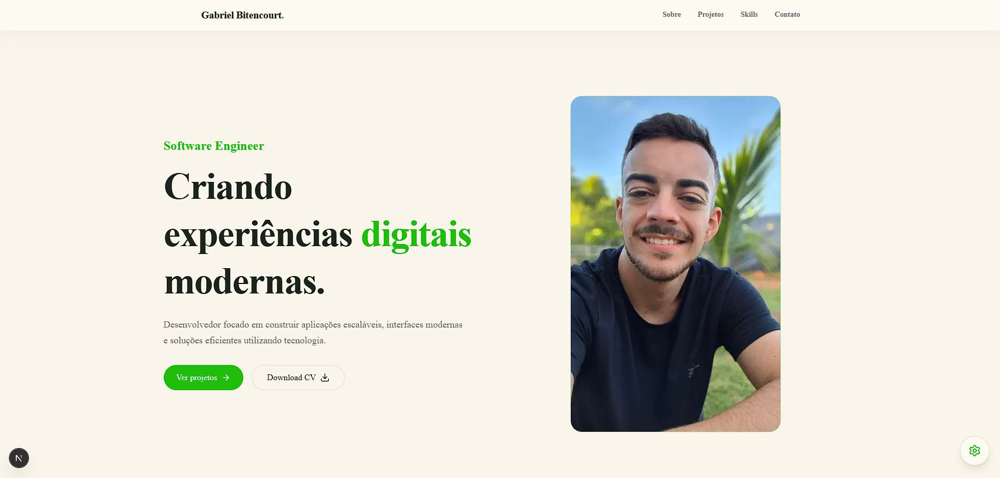

# 🚀 Gabriel Bitencourt - Portfolio

<h3 align="center">
  Meu portfólio pessoal desenvolvido para apresentar meus projetos,
  habilidades e trajetória como Software Engineer.
</h3>


## ✨ Sobre o Projeto

Este projeto é meu portfólio pessoal desenvolvido com foco em uma
experiência moderna, responsiva e intuitiva.

A aplicação apresenta minha trajetória profissional, projetos
desenvolvidos, principais tecnologias utilizadas e formas de contato.

O objetivo foi criar uma interface limpa e profissional, utilizando
boas práticas de desenvolvimento frontend.


## 🖥️ Preview




## 🚀 Tecnologias utilizadas

### Frontend

- Next.js
- React
- TypeScript
- Tailwind CSS
- Shadcn UI
- Framer Motion


### Ferramentas

- Git
- GitHub
- ESLint
- Vercel


## 🔥 Funcionalidades

- ✅ Layout totalmente responsivo
- ✅ Navegação com scroll suave
- ✅ Active link baseado na seção atual
- ✅ Menu mobile com animação lateral
- ✅ Animações utilizando Framer Motion
- ✅ Download do currículo
- ✅ Seções:
  - Home
  - Sobre
  - Projetos
  - Skills
  - Contato

## ⚙️ Como executar o projeto

Clone o repositório:

```bash
git clone https://github.com/seu-usuario/gabriel-portfolio.git
